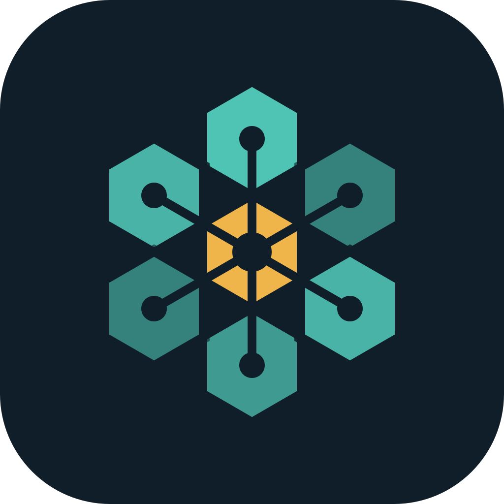

<p align="center"></p>

# MyrmidLM

**Viele kleine Rechner, ein großes Sprachmodell.** MyrmidLM bündelt Linux-PCs (NVIDIA, AMD, Intel) und Android-Handys im eigenen Netz zu einem Cluster. Er stellt lokale LLMs als OpenAI-kompatible API bereit, mit Dashboard, Router und automatischen Updates.

*Many small machines, one large language model: a self-hosted LLM cluster of Linux PCs and phones on your own network.*

Der Name kommt von den Myrmidonen, griechisch μύρμηξ, „Ameise“: viele, die zusammen etwas tragen, das keiner allein schafft.

## Was es kann

- **Ein Modell über mehrere Rechner verteilen.** Ein Master verteilt die Layer auf seine GPU(s) und auf Worker (PCs mit GPU oder RAM, Handys). Die schnellsten Geräte füllt er zuerst und plant automatisch neu, wenn Geräte dazukommen oder wegfallen.
- **Mehrere ganze Modelle, ein Endpunkt.** Hosts laden je ein ganzes Modell, der Router des Masters verteilt die Anfragen nach Name, Regeln und Auslastung. Ein PC mit mehreren GPUs nutzt sie für ein großes Modell oder gibt jeder GPU ein eigenes, umschaltbar im Dashboard.
- **Schneller dank Messungen.** Der Planer lernt aus echten Messungen. Ein Entwurfsmodell (Speculative Decoding), MTP und ein MoE-Expertencache bringen zusätzliches Tempo.
- **Selbstverwaltend.** Wake-on-LAN und Schlaf, immer die schnellste Verbindung (Kabel vor WLAN). Das Modell und die Rolle eines PCs lassen sich im Dashboard umstellen.
- **Installation in einem Schritt.** Das Installationsskript erledigt Treiber (NVIDIA inklusive älterer Karten und Secure Boot), CUDA oder Vulkan, den Build, die Firewall und die Dienste.
- **Updates für den ganzen Cluster.** Jeder PC baut neue Versionen im Hintergrund. Der Master stellt alle zusammen um und geht zurück, wenn etwas nicht hochkommt.

## Installation

Auf jedem PC (Debian, Ubuntu, Linux Mint, Pop!_OS, Fedora, Arch), als normaler Benutzer mit sudo-Rechten:

```bash
curl -fsSL https://raw.githubusercontent.com/Miki84/MyrmidLM/main/install.sh | bash
```

Das Skript fragt nach der Rolle:

| Rolle | Was der PC tut |
|---|---|
| **Master** | stellt das Modell als OpenAI-API bereit (Port 8080), Dashboard auf Port 8090 |
| **Worker** | leiht dem Master GPU und RAM für ein verteiltes Modell |
| **Host** | lädt ein ganzes Modell, der Router des Masters schickt Anfragen hin |

Zuerst den Master installieren, danach Worker und Hosts. Einen Schlüssel musst du dabei nicht eintippen: Das Skript sucht den Master im Netz, und sobald der Master den neuen PC sieht, nimmt er ihn auf und gibt ihm seinen API-Key. Ab dann kann er ihn im Dashboard umschalten und aktualisieren. Aufnehmen darf ihn nur der Master, den das Skript gefunden hat; findet es keinen, nimmt ihn der erste Master, der ihn in der ersten Stunde nach dem Start sieht.

Ohne Rückfragen, zum Beispiel für einen weiteren Worker:

```bash
curl -fsSL https://raw.githubusercontent.com/Miki84/MyrmidLM/main/install.sh | bash -s -- --role worker --yes
```

Einem anderen Master zuordnen: auf dem PC `sudo rm -f /var/lib/myrmid/myrmid/cluster_key /etc/myrmid/cluster_key` und den Dienst neu starten (`sudo systemctl restart myrmid-worker` bzw. `myrmid-host`). Den Schlüssel von Hand vorgeben geht weiter mit `--cluster-key KEY` (auf dem Master: `sudo myrmid key`).

Alle Optionen zeigt `bash install.sh --help`. Das Skript kann gefahrlos erneut laufen, zum Beispiel nach dem Neustart für den NVIDIA-Treiber. Eine ältere Installation unter dem Namen PrivateLM-Node übernimmt es automatisch: Rolle, Einstellungen, API-Key, Messwerte und Modelle bleiben erhalten.

**Handys:** Die Android-App (Ordner `lib/`, `android/`) ist Worker oder Chat-Client. Sie liegt als APK am jeweiligen [Release](https://github.com/Miki84/MyrmidLM/releases) und aktualisiert sich daraus selbst. Handys und PCs müssen dasselbe RPC-Protokoll sprechen; das Dashboard zeigt, wenn ein Handy eine andere Version hat.

## Updates

Eine neue Version ist ein Git-Tag `vX.Y.Z` in diesem Repo. So läuft ein Update ab:

1. **Jede Nacht** (03:30 Uhr, zufällig bis zu einer Stunde später) prüft jeder PC das Repo. Gibt es eine neue Version, baut er sie im Hintergrund nach `/opt/myrmid/releases/X.Y.Z`, mit niedriger Priorität. Die laufenden Dienste merken davon nichts.
2. **Der Master wartet**, bis alle PCs die neue Version gebaut haben und zwei Minuten lang keine Anfrage lief. Dann stellt er alle zusammen um: erst Worker und Hosts, dann sich selbst. Master und Worker müssen dasselbe RPC-Protokoll sprechen, deshalb passiert das gemeinsam.
3. **Kommt ein Dienst nicht hoch**, geht der PC von selbst auf die vorige Version zurück. Diese Version wird danach nicht noch einmal automatisch versucht.

Wenn eine neue Version das RPC-Protokoll ändert und Handys im Plan sind, stellt der Master nicht von selbst um: Die Handys brauchen erst die neue App.

**Im Dashboard** (Bereich *Version*) gibt es:
- einen Schalter für automatisches Umstellen,
- *Jetzt prüfen* (prüft und baut auf allen PCs),
- *Jetzt umstellen*,
- *Zurück auf vorige Version*,
- eine Tabelle mit dem Stand jedes PCs.

**Auf der Kommandozeile:**

```bash
myrmid update                 # Stand: laufende, neueste und gebaute Version
sudo myrmid update check      # jetzt prüfen
sudo myrmid update prepare    # neueste bauen (ohne umzustellen)
sudo myrmid update activate   # auf die gebaute umstellen (nur dieser PC)
sudo myrmid update rollback   # zurück
sudo myrmid update auto off   # nur noch auf Klick umstellen
```

Einstellungen stehen in `/etc/myrmid/myrmid.conf`:

| Eintrag | Bedeutung |
|---|---|
| `REPO` | Herkunft der Updates, z. B. ein eigener Spiegel |
| `CHANNEL` | `stable` = Releases, `main` = jeder Stand von main |
| `AUTO` | automatisch umstellen (`on`/`off`) |
| `BACKENDS` | z. B. `cuda,vulkan` |
| `LLAMA_CPP_REPO` | Spiegel von llama.cpp, falls das Original einmal nicht erreichbar ist |

Das Build-Log liegt in `/var/lib/myrmid-update/build.log`.

Worker ohne Cluster-Key kann der Master nicht steuern: Sie stellen sich nach dem nächtlichen Bauen selbst um. Worker mit Key, die eine Woche lang vom Master nichts hören, stellen sich ebenfalls selbst um.

### Eine neue Version veröffentlichen

```bash
scripts/release.sh 1.2.0      # setzt VERSION und App-Version, Commit und Tag
git push && git push --tags   # danach baut GitHub Actions die App und legt das Release an
```

llama.cpp ändert sich nur mit einem Release: `node/LLAMA_CPP_COMMIT` und die Kopie in der App (`local_plugins/llama_flutter_android/android/src/main/cpp/llama.cpp`) gehören zusammen. Vorher auf einem Test-PC prüfen:

```bash
sudo myrmid update prepare 1.2.0
sudo myrmid update activate 1.2.0
```

## Aufbau

| Ordner | Inhalt |
|---|---|
| `node/` | PC-Teil: `myrmid.py` (Planer, Router, Dashboard, Updates), `build.sh`, systemd-Units. Ausführlich in [node/README.md](node/README.md) |
| `install.sh` | Installation, Treiber, Dienste, Übernahme alter Installationen |
| `lib/`, `android/`, `local_plugins/` | Flutter-App (Chat, Handy als Worker oder Master), siehe [docs/APP.md](docs/APP.md) |
| `scripts/release.sh` | neue Version taggen |

Auf einem PC liegen:
- das Programm in `/opt/myrmid/current` (ein Link auf `/opt/myrmid/releases/<Version>`), der Befehl `myrmid` in `/usr/local/bin`;
- Daten in `/var/lib/myrmid` (API-Key, Messwerte, Host-Modelle);
- Einstellungen in `/etc/myrmid`;
- die Dienste `myrmid-server`, `myrmid-worker` und `myrmid-host`.

## Sicherheit

Das RPC-Protokoll von llama.cpp hat keine Anmeldung. Deshalb gibt das Installationsskript die Worker-Ports nur für den Master frei. MyrmidLM gehört ins eigene LAN oder hinter ein VPN (z. B. NetBird, WireGuard), nie direkt ins Internet. API, Dashboard, Hosts und Updates sind mit dem API-Key des Masters geschützt.

## Herkunft und Lizenz

MyrmidLM ist ein Fork von [PrivateLM](https://github.com/orailnoor/cross-platform-llm-client) (cross-platform-llm-client) und steht wie das Original unter der [MIT-Lizenz](LICENSE). Rechenkern ist [llama.cpp](https://github.com/ggml-org/llama.cpp) (MIT). Aus Kompatibilitätsgründen tragen das Netzwerkprotokoll (mDNS-Dienste `_privatelm…`, QR-Codes `privatelm://`) und interne Namen der App noch den alten Namen: So finden sich App und PCs auch über Versionen hinweg.
